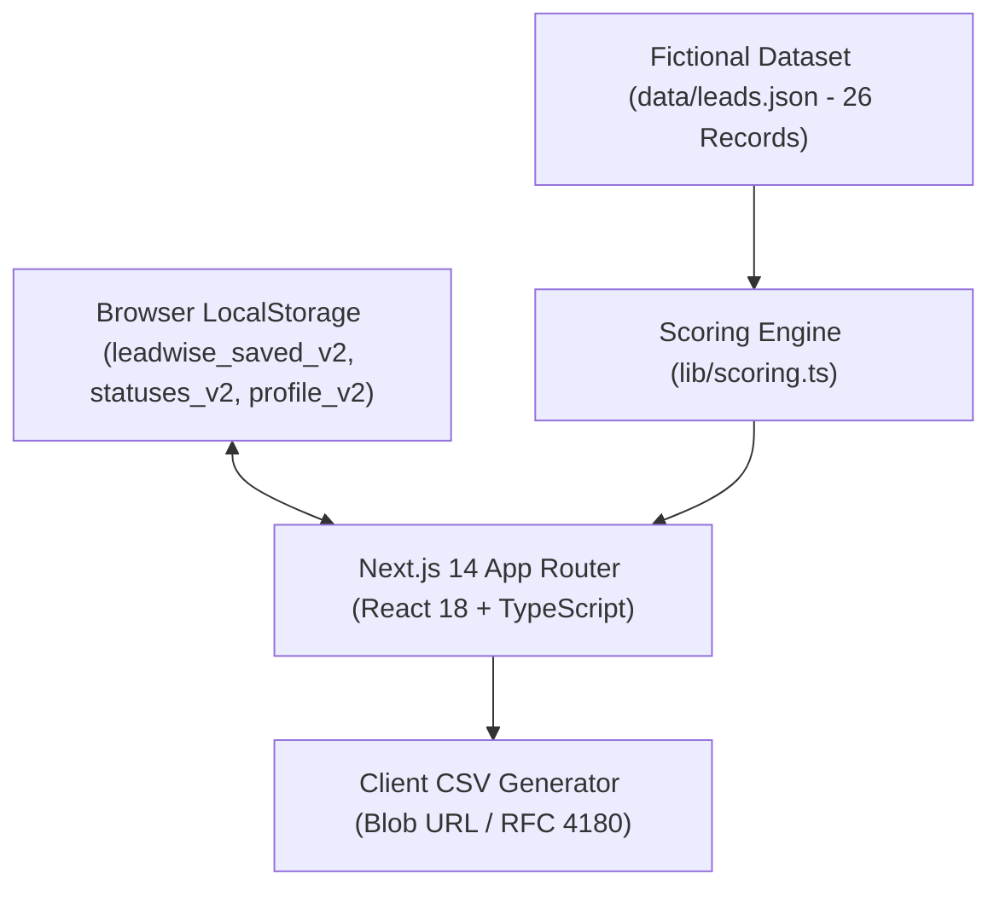
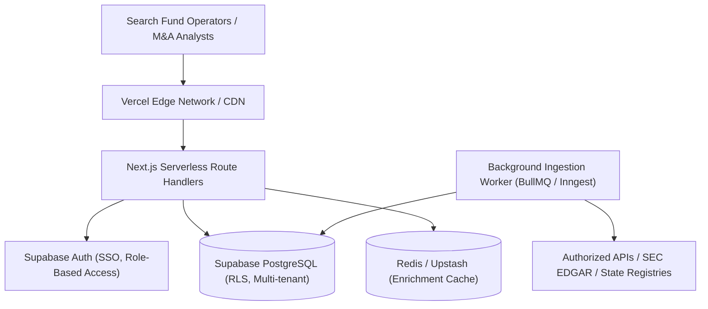

# Leadwise — B2B Lead Intelligence & Prioritization

> *"Turn company data into your next best opportunity."*

Leadwise is an internal B2B lead intelligence and prioritization platform built for acquisition entrepreneurs, private equity search funds, and M&A sourcing teams. Rather than presenting an overwhelming, uncurated catalog of raw company records, Leadwise guides operators through a structured workflow: **Lead Discovery → Lead Intelligence → Lead Prioritization → Actionable Outreach**.

This repository was created as an interview pre-work submission for **Caprae Capital**. It implements a high-impact, explainable lead-scoring engine, multi-dimensional search and filtering, interactive shortlist management, and CSV export.

---

## 1. Product Overview

In Entrepreneurship Through Acquisition (ETA) and lower-middle-market Private Equity, deal sourcing is bottlenecked not by a lack of raw companies, but by the high cognitive load of evaluating which businesses match the mandate.

Leadwise focuses on answering one critical question for the sourcing team:
> **"Which companies deserve attention first?"**

### Core Highlights
* **Deterministic, Explainable Fit Scoring:** Transparent 0–100 lead score broken down across Industry Alignment (30%), Revenue Scale (30%), Headcount & Maturity (20%), and Target Geography (20%).
* **Customizable Scoring Profiles (`/scoring`):** Operators can tune criteria weights, preferred sectors, target revenue bands, and employee ranges to match specific search mandates.
* **Deep Company Intelligence (`/companies/[id]`):** In-depth operating profile, score breakdown, rule-based "Why This Lead Matters" rationale, and data provenance indicators.
* **Active Shortlist & Pipeline Tracking (`/saved`):** Persistent saved-leads list and synchronized status workflow (`New`, `Contacted`, `Qualified`, `Disqualified`).
* **Instant Filtered CSV Export:** One-click CSV generation for downstream outreach or CRM upload.

---

## 2. Problem Statement

Commercial lead generation and web scraping tools often dump hundreds of unranked records into an unstructured table. Sourcing analysts and search fund operators face several operational hurdles:

1. **High Cognitive Overhead:** Operators must mentally cross-reference industry tags, revenue approximations, and headcount to decide if a company fits their investment thesis.
2. **Opaque or Black-Box Scoring:** Tools that label leads as "Hot" or "High Match" without explainable criteria foster distrust. Operators cannot understand *why* a company was recommended.
3. **Static Sourcing Profiles:** A PE firm targeting $10M–$30M industrial manufacturers requires a completely different prioritization heuristic than one targeting $5M B2B services.
4. **Poor Data Provenance:** Without clear indicators of data completeness, verification status, and snapshot age, analysts waste time on ghost entities or out-of-date records.

---

## 3. Solution

Leadwise tackles these challenges with a purpose-built B2B workflow:

1. **Discovery to Prioritization:** Leads are scored against a target profile as soon as they are loaded, surfacing top opportunities at the very top of the table.
2. **Transparent Rationale:** Every lead score provides an exact numerical breakdown across 4 dimensions and a human-readable summary explaining the score.
3. **Dynamic Re-Scoring:** Sourcing teams can adjust the active profile on `/scoring`; the entire workspace recalculates deterministically without external API calls or reload.
4. **Actionable Pipeline Execution:** Operators shortlist promising leads, track outreach statuses, and export filtered cohorts directly to CSV.

---

## 4. Key Features

| Feature | Description | Status |
| :--- | :--- | :--- |
| **Explainable Fit Scoring Engine** | Calculates a 0–100 score based on 4 weighted criteria with explainable rationale. | **Implemented in Prototype** |
| **Configurable Scoring Profile** | Interactive UI on `/scoring` with 100% weight validation and live dataset simulation. | **Implemented in Prototype** |
| **Multi-Parameter Filter Toolbar** | Search, Industry, Location, Revenue, Headcount, Score Tier, Pipeline Status, Verification, Saved-Only. | **Implemented in Prototype** |
| **Interactive Pipeline Tracking** | Update status (`New`, `Contacted`, `Qualified`, `Disqualified`) synchronized across all pages via `localStorage`. | **Implemented in Prototype** |
| **Company Intelligence View** | Dedicated route (`/companies/[id]`) with deep score factor inspection and data provenance audit. | **Implemented in Prototype** |
| **Shortlist Management** | Dedicated saved leads workspace (`/saved`) with live count badge in sidebar. | **Implemented in Prototype** |
| **Filtered CSV Export** | Client-side RFC-compliant CSV generation matching currently applied filters. | **Implemented in Prototype** |
| **Non-Intrusive Feedback Toasts** | Floating toast system providing confirmations for saves, status updates, exports, and profile changes. | **Implemented in Prototype** |
| **Supabase PostgreSQL & Auth** | Multi-tenant workspace database, row-level security, and persistent team accounts. | *Production Architecture Plan* |
| **Automated Data Ingestion & Enrichment** | Continuous ingestion from permitted public filings and authorized commercial registries. | *Production Architecture Plan* |

---

## 5. Why These Features Were Selected

In a five-hour engineering pre-work assignment, attempting to build a web scraper or connecting third-party paid APIs introduces rate-limiting fragility, CAPTCHA hurdles, and low value to the user experience.

Instead, we prioritized:
1. **Explainable Scoring Engine (`lib/scoring.ts`):** Directly solves the primary business pain point—prioritization. It provides transparent criteria that operators can trust.
2. **Configurable Target Profiles (`/scoring`):** Demonstrates full-stack business judgment. M&A mandates change; the software must adapt to different buy-box criteria dynamically.
3. **Robust Data State Synchronization (`lib/storage.ts`):** Guarantees that updating a lead's status or saving a lead on the dashboard immediately reflects on the company detail page, saved leads view, and sidebar counter.
4. **Professional B2B UI/UX:** Prioritizes high information density, neutral tones, accessible typography, and keyboard navigation over AI-style gradients or gimmicky templates.

---

## 6. Scoring Methodology

The prototype scoring engine operates deterministically. By default, it allocates 100 total points across four dimensions:

### 1. Industry Alignment (30% Weight)
* **Primary Target Match:** 100% of weight (30 pts). Awarded to core industries in the search mandate (e.g., *Industrial Manufacturing, Packaging, Wholesale Distribution, Industrial Services, Environmental Services, Transportation Services, Business Services*).
* **Secondary / Adjacent Match:** ~45% of weight (14 pts). Awarded to adjacent service firms (*IT Services, Healthcare Services, Professional Services*).

### 2. Revenue Scale Fit (30% Weight)
* **Sweet Spot ($10M–$30M):** 100% of weight (30 pts). Matches optimal platform size for lower-middle-market ETA investment.
* **Tolerance Band ($6M–$45M):** 65% of weight (20 pts). Scalable, but either slightly smaller than target or requiring larger capital syndicate.
* **Outside Range:** 30% of weight (9 pts).

### 3. Headcount & Organizational Maturity (20% Weight)
* **Sweet Spot (50–200 employees):** 100% of weight (20 pts). Indicates middle management, operational delegation, and non-owner dependency.
* **Tolerance Band (25–320 employees):** 60% of weight (12 pts).
* **Outside Range:** 25% of weight (5 pts).

### 4. Target Geography (20% Weight)
* **Domestic Primary Market (US):** 100% of weight (20 pts).
* **Cross-Border / Non-Target:** 25% of weight (5 pts).

### Tier Thresholds
* **High Fit:** Score $\ge 80$
* **Medium Fit:** Score $65 \le \text{Score} < 80$
* **Low Fit:** Score $< 65$

> **Transparency Note:** Fit scores represent a prioritization heuristic based on target search criteria. They do not constitute financial advice or predict the likelihood of an owner agreeing to sell.

---

## 7. UX / UI Design Decisions

* **Executive Dark Obsidian Aesthetic:** Built with a high-contrast dark theme (`#090d16` obsidian canvas, `#111827`/`#0f172a` elevated card surfaces, `#f8fafc` primary typography, and electric sapphire `#6366f1` / vibrant emerald `#10b981` indicators). Designed to look like a high-performance executive workstation (Linear/PitchBook/Mercury) rather than a generic SaaS template.
* **Full-Width Top-Nav Workspace:** Features a streamlined executive top navigation bar with workspace switcher (`Caprae ETA Fund I`), active thesis pills, and global navigation links. Maximizes screen width so the pipeline table and filters have superior breathing room and zero horizontal cramping.
* **Corporate Facility & Building Logo Badges:** In place of raw initial letters, each company displays a tailored architectural and corporate building logo icon (manufacturing plants, logistics warehouses, healthcare facilities, commercial office buildings) with subtle category styling.
* **Information Density:** Compact table rows, tabular numerical formatting (`$18.5M`), and clearly legible tier badges with glowing micro-indicators.
* **Zero Dead Controls:** Every button, select dropdown, search field, and link performs an active function with instant user feedback via the toast notification system.
* **Mobile & Tablet Responsive:** The top navigation collapses to a clean mobile drawer, table containers support smooth horizontal scrolling without layout breaking, and filters wrap cleanly.
* **Keyboard Accessibility:** Form controls and action buttons include visible focus rings (`:focus-visible`), standard semantic HTML elements, and ARIA labels.

---

## 8. Technical Architecture

### Implemented in This Prototype



* **Framework:** Next.js 14 App Router (`next: ^14.2.35`, `react: ^18.3.1`, `typescript: ^5.7.2`).
* **Styling:** Tailwind CSS + Vanilla CSS custom tokens in `app/globals.css`.
* **Icons:** `lucide-react`.
* **State & Persistence:** Browser `localStorage` with a custom window event bus (`leadwise:sync`) ensuring real-time multi-page reactivity.
* **Scoring Engine:** Deterministic pure TypeScript calculation module (`lib/scoring.ts`).
* **Export Engine:** Client-side CSV generator using `Blob` URL and RFC 4180 quotation escaping (`lib/export.ts`).

---

### Proposed Production Architecture (Not Implemented)

For a production deployment at scale, the architecture would evolve as follows:



1. **Frontend & Compute:** Next.js deployed on **Vercel** with edge caching and serverless API Route Handlers.
2. **Database:** **Supabase PostgreSQL** with Row-Level Security (RLS) enforcing workspace-level data isolation.
3. **Authentication:** Supabase Auth supporting magic links, Google OAuth, and SAML/SSO for enterprise funds.
4. **Caching Layer:** Redis (Upstash) caching third-party company lookups by canonical domain with a 30-day TTL to minimize external API costs.
5. **Deduplication Engine:** Ingestion pipeline normalizes company names, strips URL schemes/paths to match on canonical domain (`tldextract`), and flags duplicates for human review if address/EIN match.
6. **Security & Compliance:** Environment variables strictly isolated to server runtimes, rate-limited public endpoints, and comprehensive audit logs for all lead exports.

---

## 9. Data Model

### Lead Record Schema
```typescript
export interface Lead {
  id: string;                      // Unique ID (e.g. "L-1001")
  company: string;                 // Company name
  website: string;                 // Domain name
  industry: string;                // Primary operating sector
  location: string;                // State/Country (e.g. "Ohio, US")
  revenue: number;                 // Estimated annual revenue in $M USD
  employees: number;               // Headcount estimate
  description: string;             // Business description
  source: string;                  // Ingestion provenance
  status: PipelineStatus;          // "New" | "Contacted" | "Qualified" | "Disqualified"
  verified: boolean;               // Verification flag
  verificationStatus: VerificationStatus; // "Verified" | "Needs review" | "Incomplete"
  lastVerifiedAt: string;          // ISO date string
  dataCompleteness: number;        // Percentage (0–100)
}
```

### Proposed Production Database Schema (PostgreSQL)
```sql
-- Organizations (Canonical Companies)
CREATE TABLE organizations (
    id UUID PRIMARY KEY DEFAULT gen_random_uuid(),
    canonical_domain TEXT UNIQUE NOT NULL,
    company_name TEXT NOT NULL,
    industry TEXT NOT NULL,
    location TEXT NOT NULL,
    estimated_revenue NUMERIC(10, 2),
    estimated_employees INT,
    description TEXT,
    verification_status TEXT DEFAULT 'Needs review',
    created_at TIMESTAMPTZ DEFAULT NOW(),
    updated_at TIMESTAMPTZ DEFAULT NOW()
);

-- Workspace Leads (M&A Pipeline)
CREATE TABLE workspace_leads (
    id UUID PRIMARY KEY DEFAULT gen_random_uuid(),
    workspace_id UUID REFERENCES workspaces(id) ON DELETE CASCADE,
    organization_id UUID REFERENCES organizations(id) ON DELETE CASCADE,
    status TEXT DEFAULT 'New' CHECK (status IN ('New', 'Contacted', 'Qualified', 'Disqualified')),
    is_saved BOOLEAN DEFAULT FALSE,
    notes TEXT,
    updated_at TIMESTAMPTZ DEFAULT NOW(),
    UNIQUE(workspace_id, organization_id)
);

-- Scoring Profiles
CREATE TABLE scoring_profiles (
    id UUID PRIMARY KEY DEFAULT gen_random_uuid(),
    workspace_id UUID REFERENCES workspaces(id) ON DELETE CASCADE,
    name TEXT NOT NULL,
    weights_json JSONB NOT NULL,
    criteria_json JSONB NOT NULL,
    is_active BOOLEAN DEFAULT TRUE,
    created_at TIMESTAMPTZ DEFAULT NOW()
);
```

---

## 10. Performance Considerations

* **Client-Side Latency:** All scoring calculations in the prototype execute in sub-millisecond time across the 26 sample records via memoized React computations (`useMemo`).
* **Optimized Bundle Size:** Built with native HTML form controls and modular `lucide-react` icons. Zero heavy third-party UI component libraries or animation engines.
* **Production Scalability:** For datasets exceeding 10,000+ leads:
  * Server-side pagination and SQL-indexed queries on `(workspace_id, status, fit_score)`.
  * Pre-computing lead fit scores in PostgreSQL generated columns or materialized views upon scoring profile update.
  * Streaming CSV export via HTTP chunked transfer rather than loading all records into browser memory.

---

## 11. Data Quality & Verification

In real-world acquisition sourcing, data quality can make or break an outreach campaign. Leadwise models data quality through three subtle indicators:

1. **`Verified` (Green):** Financial scale, employee headcount, and domain have been confirmed via official state corporate filings, SEC Form D records, or trade accreditations.
2. **`Needs Review` (Amber):** Financial metrics are derived from modeled estimations rather than direct filings; requires manual confirmation before outreach.
3. **`Incomplete` (Slate):** Key fields (such as headcount or full location) are partially missing.

> **Evaluation Disclaimer:** All 26 records in this repository are fictional sample companies created solely for interview demonstration. They do not represent real businesses.

---

## 12. Privacy & Ethical Ingestion Guidelines

A production lead intelligence platform must operate in strict compliance with ethical and legal data standards:
* **Terms of Service Compliance:** Ingest only from permitted public datasets (e.g. SEC EDGAR, state business entity filings) or authorized paid data partners (e.g. Dun & Bradstreet, ZoomInfo, Clearbit API).
* **No Unauthorized Scraping:** Strictly adhere to website `robots.txt` guidelines, do not bypass access barriers or CAPTCHAs, and respect rate-limiting policies.
* **CAN-SPAM & GDPR/CCPA Compliance:** Store only commercial business contact information; never harvest private personal data or bypass unsubscribe preferences.

---

## 13. Local Setup & Running

### Requirements
* Node.js 18.17+ or 20.x
* npm 9+

### Installation Steps
```bash
# 1. Clone or navigate to the project directory
cd /Users/apple/Downloads/caprae-lead-intelligence

# 2. Install dependencies
npm install

# 3. Start development server
npm run dev
```

Open [http://localhost:3000](http://localhost:3000) in your browser.

---

## 14. Verification & Production Build

To verify TypeScript correctness, linting, and production compilation:

```bash
npm run build
```

**Build Output Verification:**
```
Route (app)                              Size     First Load JS
┌ ○ /                                    7.5 kB          111 kB
├ ○ /_not-found                          873 B          88.1 kB
├ ƒ /companies/[id]                      6.8 kB          110 kB
├ ○ /saved                               4.92 kB         109 kB
└ ○ /scoring                             3.53 kB         107 kB
+ First Load JS shared by all            87.3 kB
```
* Status: **Zero TypeScript errors, zero lint warnings, all 6 routes compiled successfully.**

---

## 15. Limitations of Current Prototype

1. **Client-Side Persistence:** Relies on browser `localStorage`. Status updates and custom scoring profiles do not sync across different browsers or team members.
2. **Sample Dataset Size:** Contains 26 fictional records. In a production environment, datasets would span tens of thousands of records requiring server-side pagination.
3. **Static Enrichment Data:** Field verification badges and completeness metrics are illustrative attributes of the JSON dataset rather than live API calls.
4. **Single Active Profile:** While profiles can be configured and reset, saving multiple named scoring profiles (e.g., "Healthcare Mandate" vs "Industrial Mandate") requires database support.

---

## 16. Future Improvements

1. **Multi-Thesis Profiles:** Allow users to switch between saved mandate profiles (e.g., "Plumbing & HVAC Search" vs "B2B SaaS Buy-and-Build").
2. **CRM Integration:** Add 1-click sync to HubSpot, Salesforce, or Attio via OAuth webhooks.
3. **Automated De-Duplication:** Implement Levenshtein-distance fuzzy matching to catch duplicate company entities with slight spelling variations.
4. **Team Activity Feed:** Add multi-user notes and outreach logs directly onto `/companies/[id]`.
5. **Enrichment API Adapters:** Connect to OpenCorporates or Clearbit API with fallback caching in Redis.

---

## Repository Structure

```
caprae-lead-intelligence/
├── app/
│   ├── layout.tsx              # Root layout with Sidebar and Toast provider
│   ├── page.tsx                # Lead Intelligence Dashboard (/)
│   ├── globals.css             # Design tokens and custom utilities
│   ├── companies/
│   │   └── [id]/
│   │       └── page.tsx        # Company Detail View (/companies/[id])
│   ├── saved/
│   │   └── page.tsx            # Shortlisted Leads (/saved)
│   └── scoring/
│       └── page.tsx            # Scoring Profile Configuration (/scoring)
├── components/
│   ├── TopNav.tsx              # Executive workspace top navigation bar & mobile drawer
│   ├── Topbar.tsx              # Semantic breadcrumbs & workspace metadata
│   ├── CompanyLogo.tsx         # Corporate facility and building logo icons
│   ├── StatCard.tsx            # Executive dark KPI card
│   ├── LeadTable.tsx           # High-density lead table with building marks
│   ├── LeadFilters.tsx         # Multi-field search & filter toolbar
│   ├── LeadScore.tsx           # Fit score indicator & tier badge
│   ├── ScoreBreakdown.tsx      # Explainable score component breakdown
│   ├── StatusSelect.tsx        # Pipeline stage selector with color indicators
│   ├── SaveLeadButton.tsx      # Accessible bookmark save/unsave toggle
│   ├── EmptyState.tsx          # Clean empty state for filters & lists
│   └── Toast.tsx               # Non-intrusive floating feedback toasts
├── data/
│   └── leads.json              # 26 diverse, fictional B2B sample leads
├── lib/
│   ├── leads.ts                # Types, interfaces, and helpers
│   ├── scoring.ts              # Deterministic scoring engine & explanations
│   ├── storage.ts              # LocalStorage persistence & event bus
│   └── export.ts               # RFC-compliant CSV export utility
├── docs/
│   └── business-answers.md     # Pre-work business understanding notes
└── README.md                   # Comprehensive technical documentation
```
